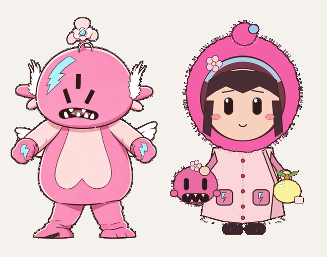

# 福塔桌宠 3.1 · 睡衣女孩主题

> 3.1 新增第二套主题：穿粉色毛绒连帽睡衣、抱着福塔玩偶的小女孩。行为与福塔主题完全一致，只换立绘与个别锚点。

## 1. 设计取舍

照片里最有记忆点的三件事：**毛绒连帽睡衣、举在脸前的福塔玩偶、手里的柠檬**。

- **与福塔同比例**：大头小身、短手短脚，头约占全图一半，和福塔摆在一起时比例一致；共用 290×436 画布与 2px 墨线描边。
- **脸露出来**：参考照是玩偶遮脸，但立绘需要辨识度，最终选择「玩偶抱在脸侧、女孩露脸」——远看是「抱着福塔的睡衣女孩」，近看能认出人。
- **福塔基因延续**：睡衣保留亮粉主体、蓝色内衬、口袋上的蓝色闪电贴片；柠檬玩偶保留亮黄与叶子。
- **程序绘制**：没有图生图工具，这张立绘由 tools/make_pajama_theme.py 以 4 倍超采样生成后缩放，保证边缘干净。它是 3.1 的「可替换占位正式图」：以后有更好的立绘，按下面规格换文件即可。

## 2. 与福塔主题的差异

| 项 | 福塔 | 睡衣女孩 |
| --- | --- | --- |
| 立绘 | assets/futa-subject.png | assets/pajama-girl.png |
| 飞行帧 | 翅膀 + 下半身形变 | 整体轻微摇摆（无翅膀） |
| 嘴部锚点 | (123, 188) | (94, 256)，落在地手里的福塔玩偶上 |
| 咬人表现 | 本体咬 | 玩偶「替她咬」 |

## 3. 技术实现

- 主题注册表 THEMES：名称、立绘文件、是否有翅膀、嘴部锚点，都在 src/futa_pet.py 顶部。
- prepare_wings 按主题分流：有翅膀走原来的翅膀/裙摆形变，无翅膀走 prepare_sway_frames 的 60 帧摇摆。
- set_theme 切换时重新载入立绘、重建帧、清缓存、刷新窗口并保存。
- 设置面板新增「桌宠主题」单选项；配置写入 settings.json 的 theme 字段。
- 打包脚本同时打入两张立绘。

## 4. 替换成正式立绘的规格

- PNG，290×436，透明背景，脚底约 y=424。
- 全图统一 2px 深色描边（约 #4C2628）。
- 若嘴部位置不同，改 THEMES["girl"]["mouth"] 即可。
- 换完重新运行 build.ps1 打包。

## 5. 重新生成当前占位图

    python tools/make_pajama_theme.py

脚本会覆盖 assets/pajama-girl.png。
